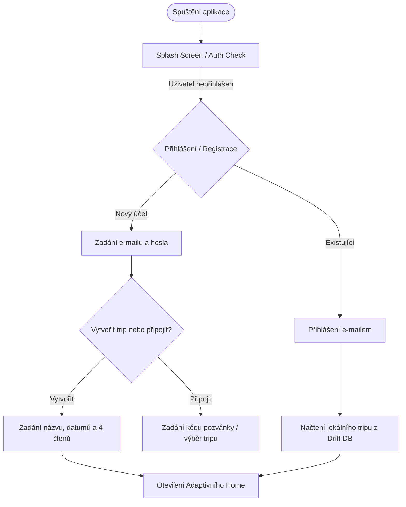
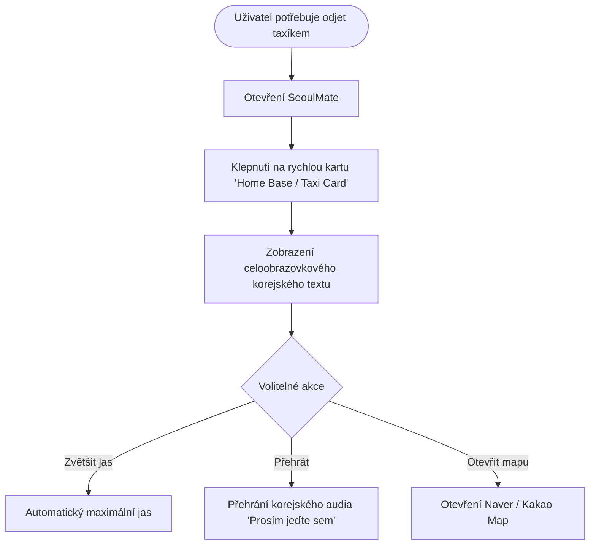
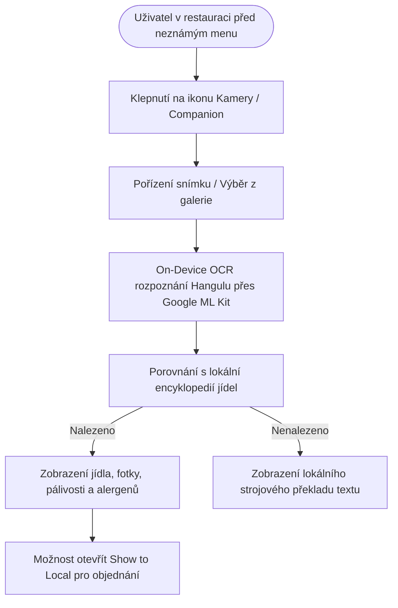
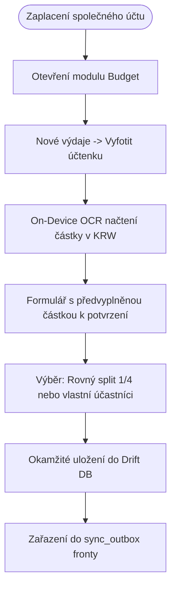

# SeoulMate v2.0 — Uživatelské toky (User Flows)

**Verze:** 2.0  
**Stav:** APPROVED SPECIFICATION  
**Poslední aktualizace:** 15. srpna 2026  
**Nadřazený dokument:** [00_MASTER_PLAN.md](00_MASTER_PLAN.md)  
**Rozcestník:** [DOCUMENTATION_INDEX.md](DOCUMENTATION_INDEX.md)  
**Katalog obrazovek:** [07_SCREEN_CATALOG.md](07_SCREEN_CATALOG.md)

---

## 1. Přehled klíčových uživatelských toků

1. **FLOW-01:** Onboarding a vstup do soukromého tripu
2. **FLOW-02:** Přidání místa z Trip Inboxu a skupinové hlasování
3. **FLOW-03:** Plánování a úprava denního itineráře (Smart Itinerary)
4. **FLOW-04:** Uložení a offline přístup k dokladům ve Vaultu
5. **FLOW-05:** Průchod dnem v terénu a adaptivní „Co teď?“
6. **FLOW-06:** Noční návrat — Taxi Card a Show to Local
7. **FLOW-07:** Camera Companion — On-device OCR, překlad a alergeny
8. **FLOW-08:** Záznam výdaje s OCR účtenky a rozpočítáním
9. **FLOW-09:** Řešení synchronizačního stavu v Sync Centru a Decision Centru
10. **FLOW-10:** Vytvoření denní kroniky a mobilní export PDF Trip Booku

---

## 2. Detailní specifikace hlavních toků

### FLOW-01: Onboarding a vstup do soukromého tripu

- **Happy Path:** Uživatel se přihlásí, aplikace okamžitě načte lokální data z Drift DB a zobrazí Home.
- **Offline Path:** Pokud chybí síť, aplikace použije lokální uloženou session a načte data z disku bez chybové hlášky.

---

### FLOW-06: Noční návrat — Taxi Card a Show to Local

- **Happy Path:** 1 klepnutí z Home -> okamžité zobrazení adresy hotelu Hangulem s velkým kontrastním písmem.
- **Offline Path:** 100% funkční offline, adresa i korejský přepis jsou uloženy lokálně.

---

### FLOW-07: Camera Companion — OCR korejského menu a lokální překlad

- **Happy Path:** Fotka menu -> nalezeno v lokální databázi -> zobrazení „Bibimbap (nepálivé, vejce)“.
- **Error Path:** Rozostřený snímek -> zobrazení hlášky: „Text se nepodařilo přečíst, zkuste fotit z menší vzdálenosti nebo vybrat jídlo ručně ze seznamu.“

---

### FLOW-08: Záznam výdaje s OCR účtenky

- **Happy Path:** Vyfocení účtenky -> načtení částky 48 000 KRW -> potvrzení -> split na 4 (12 000 KRW / osoba) -> uloženo.
- **Offline Path:** Zápis proběhne okamžitě do lokální DB; změna se odešle do Firebase, jakmile se zařízení připojí k internetu.
