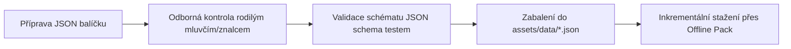

# SeoulMate v2.0 — Obsahová strategie a správa dat (Content Strategy)

**Verze:** 2.0  
**Stav:** APPROVED SPECIFICATION  
**Poslední aktualizace:** 15. srpna 2026  
**Nadřazený dokument:** [00_MASTER_PLAN.md](00_MASTER_PLAN.md)  
**Rozcestník:** [DOCUMENTATION_INDEX.md](DOCUMENTATION_INDEX.md)  
**Inventář obsahu:** [CONTENT_INVENTORY.md](CONTENT_INVENTORY.md)

---

## 1. Pravidla fonetického přepisu korejštiny (Hangul -> Čeština)

Korejština má specifickou fonetiku, která se často liší od standardní anglické revidované romanizace (RR). V SeoulMate uvádíme u všech frází a názvů:
1. **Původní korejský Hangul** (např. 안녕하세요)
2. **Revidovanou mezinárodní romanizaci** (např. *Annyeonghaseyo*)
3. **Českou přibližnou fonetickou výslovnost v hranatých závorkách** (např. *[a-ňong-ha-se-jo]*)

### Pravidla české transkripce:
- `ㅓ` (eo) přepisujeme jako české otevřené `[o]`.
- `ㅕ` (yeo) přepisujeme jako `[jo]`.
- `ㅡ` (eu) přepisujeme jako `[y]` nebo temné `[u]`.
- `ㄱ/ㅂ/ㄷ` na začátku slova přepisujeme přirozeně jako měkčí `[k/p/t]`.
- Dlouhé nebo zdvojené souhlásky `ㄲ/ㅃ/ㄸ` značíme jako rázné `[kk/pp/tt]`.

---

## 2. Bezpečnostní pravidla pro obsah jídel a alergenů

Všechna jídla v modulu **Food Guide** musí obsahovat:
- **Kategorie surovin:** Hlavní báze (rýže, nudle, polévka, grilované maso).
- **Způsob přípravy:** Vaření, smažení, grilování na stole, kvašení.
- **Stupeň pálivosti (Scoville scale indicator):** 0/3 (nepálivé) až 3/3 (extrémně pálivé).
- **Varovný blok skrytých složek:**
  - `⚠️ Upozornění pro vegetariány`: Zda omáčka obsahuje rybí vývar (*myeolchi yuksu*) nebo krevety (*saeujeot*).
  - `⚠️ Alergeny`: Arašídy, sezam, sója, vejce, lepek, korýši.
- **Způsob objednání:** Praktické tipy (např. minimální objednávka 2 porcí u BBQ).
- **Související fráze:** Přímé odkazy na fráze pro objednání a úpravu jídla.

---

## 3. Workflow tvorby, verzování a aktualizace obsahu

- Každý obsahový balíček obsahuje pole: `version`, `lastReviewedAt`, `author`, `hash`.
- Obsah je dodáván přímo v aplikaci v instalačním balíčku a může být volitelně aktualizován přes Offline Trip Pack.
