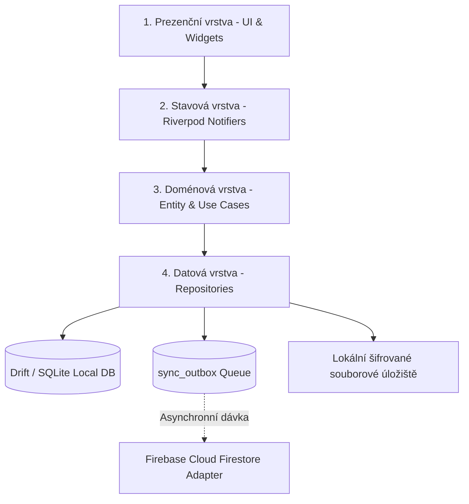

# SeoulMate v2.0 — Technická architektura (Technical Architecture)

**Verze:** 2.0  
**Stav:** APPROVED SPECIFICATION  
**Poslední aktualizace:** 15. srpna 2026  
**Nadřazený dokument:** [00_MASTER_PLAN.md](00_MASTER_PLAN.md)  
**Rozcestník:** [DOCUMENTATION_INDEX.md](DOCUMENTATION_INDEX.md)  
**Datový model:** [13_DATA_MODEL.md](13_DATA_MODEL.md)  
**Synchronizace:** [14_SYNC_AND_CONFLICTS.md](14_SYNC_AND_CONFLICTS.md)

---

## 1. Architektonické vrstvy aplikace

SeoulMate v2.0 využívá čistou čtyřvrstvou Feature-First architekturu:

### 1.1 Prezenční vrstva (Presentation Layer)
- Flutter widgety, obrazovky a komponenty.
- **Pravidlo:** Žádná byznys logika ani přímé volání sítě ve widgetech. Veškerý stav je sledován přes Riverpod providery (`ref.watch`).

### 1.2 Stavová vrstva (Application / State Layer)
- `AsyncNotifier` a `StateNotifier` z balíčku `flutter_riverpod`.
- Poskytuje reaktivní streamy dat z repozitářů a vystavuje metody pro uživatelské akce.

### 1.3 Doménová vrstva (Domain Layer)
- Čisté Dart modely generované přes `freezed` s neměnnými vlastnostmi (`@freezed`).
- Validační byznys pravidla (např. kontrola shody 4 hlasů, výpočet splitu výdajů, detekce časových konfliktů).

### 1.4 Datová vrstva (Data Layer)
- **Local-First Repository Pattern:** Repozitáře (`TripRepository`, `PlacesRepository`, `BudgetRepository`) čtou i zapisují do lokální **Drift / SQLite** databáze.
- **Outbox Sync Service:** Každý lokální zápis vytvoří záznam v tabulce `sync_outbox`. Background worker pak asynchronně odesílá dávky do **Cloud Firestore**.
- **Chráněné lokální soubory:** Doklady ve Vaultu jsou ukládány přímo na disk s AES-256 šifrováním a klíči v `flutter_secure_storage` (bez závislosti na Firebase Storage).

---

## 2. Klíčové technologie a balíčky

| Komponenta | Zvolená technologie | Licence | Důvod volby |
|---|---|---|---|
| **Framework** | Flutter (Dart SDK `^3.12`) | BSD-3-Clause | Multiplatformní kód, nativní výkon, špičkové UI |
| **State Management** | `flutter_riverpod: ^3.3.2` | MIT | Předvídatelný reaktivní stav, testovatelnost, DI |
| **Navigace** | `go_router: ^17.3.0` | BSD-3-Clause | Deklarativní URL routing, podpora deep linků a auth redirectů |
| **Lokální DB** | `drift` + `sqlite3_flutter_libs` | MIT / BSD | Typově bezpečná SQLite DB, reaktivní streamy dotazů |
| **Cloud Sync** | `cloud_firestore: ^6.7.1` | Apache-2.0 | Asynchronní synchronizace pro 4 uživatele v rámci Spark tieru |
| **Modely** | `freezed` + `json_serializable` | MIT | Imutabilita, copyWith, deterministická JSON serializace |
| **On-device OCR** | `google_mlkit_text_recognition` | **Apache-2.0** | 100% lokální rozpoznání korejského textu bez poplatků |
| **PDF Export** | `pdf` + `printing` | Apache-2.0 / MIT | Generování tisknutelného PDF Trip Booku přímo v mobilu |
| **Zabezpečení** | `flutter_secure_storage` | BSD-3-Clause | Hardwarově šifrované klíče (Android Keystore / iOS Keychain) |
