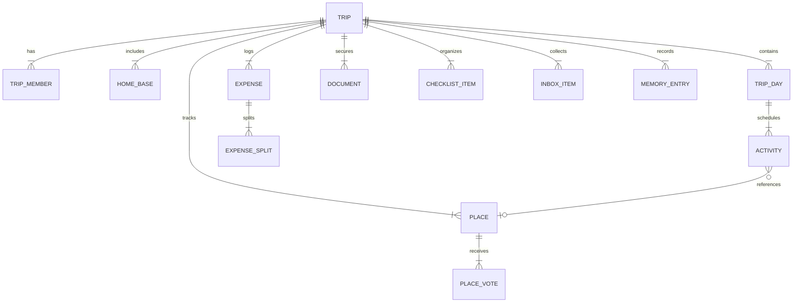

# SeoulMate v2.0 — Datový model a schémata (Data Model & Schemas)

**Verze:** 2.0  
**Stav:** APPROVED SPECIFICATION  
**Poslední aktualizace:** 15. srpna 2026  
**Nadřazený dokument:** [00_MASTER_PLAN.md](00_MASTER_PLAN.md)  
**Rozcestník:** [DOCUMENTATION_INDEX.md](DOCUMENTATION_INDEX.md)  
**Architektura:** [12_TECHNICAL_ARCHITECTURE.md](12_TECHNICAL_ARCHITECTURE.md)

---

## 1. Entitní relační model (ER Diagram)

---

## 2. Definice klíčových lokálních tabulek (Drift / SQLite)

### 2.1 Tabulka `trips`
- `id` (TEXT, PK): Unikátní UUID tripu.
- `title` (TEXT): Název tripu (např. „Soul & Busan 2026“).
- `startDate` (INTEGER): Časové razítko začátku cesty.
- `endDate` (INTEGER): Časové razítko konce cesty.
- `timeZone` (TEXT): Primární časové pásmo (`Asia/Seoul`).
- `baseCurrency` (TEXT): Výchozí měna (`KRW`).
- `secondaryCurrency` (TEXT): Sekundární měna (`CZK`).
- `createdAt` / `updatedAt` (INTEGER): Časová razítka.
- `version` (INTEGER): Číslo revize pro řešení konfliktů.

### 2.2 Tabulka `trip_members`
- `id` (TEXT, PK): UUID člena.
- `tripId` (TEXT, FK -> trips.id).
- `userId` (TEXT): Firebase Auth UID.
- `displayName` (TEXT): Jméno člena.
- `avatarAsset` (TEXT): Cesta k lokálnímu avataru.
- `dietaryRestrictions` (TEXT): Alergie a stravovací omezení (JSON array).
- `emergencyContact` (TEXT): Telefon a jméno kontaktu v ČR.

### 2.3 Tabulka `home_bases`
- `id` (TEXT, PK): UUID ubytování.
- `tripId` (TEXT, FK -> trips.id).
- `nameLatin` (TEXT): Název hotelu v latince.
- `nameKorean` (TEXT): Název hotelu v korejštině (Hangul).
- `addressKorean` (TEXT): Plná korejská adresa pro taxi.
- `latitude` / `longitude` (REAL): GPS souřadnice.
- `checkIn` / `checkOut` (INTEGER): Časová razítka.
- `documentId` (TEXT, Nullable, FK -> documents.id): Odkaz na voucher.

### 2.4 Tabulka `trip_days` a `activities`
- `trip_days`: `id`, `tripId`, `dayNumber`, `dateTimestamp`, `themeNote`.
- `activities`: `id`, `tripDayId`, `orderIndex`, `title`, `timeSlot`, `durationMinutes`, `placeId` (Nullable), `notes`, `isCompleted`.

### 2.5 Tabulka `places` a `place_votes`
- `places`: `id`, `tripId`, `nameLatin`, `nameKorean`, `category`, `neighborhood`, `latitude`, `longitude`, `priceLevel`, `tags` (JSON), `notes`, `isFavorite`.
- `place_votes`: `id`, `placeId`, `userId`, `voteType` (`upvote`, `downvote`, `neutral`), `updatedAt`.

### 2.6 Tabulka `documents` (Travel Vault — 100% lokální úložiště)
- `id` (TEXT, PK): UUID dokumentu.
- `tripId` (TEXT, FK -> trips.id).
- `title` (TEXT): Popis dokladu (např. „Letenka Soul – Praha“).
- `category` (TEXT): `flight`, `hotel`, `insurance`, `ticket`, `other`.
- `localFilePath` (TEXT): Cesta k šifrovanému lokálnímu souboru na disku.
- `mimeType` (TEXT): `application/pdf`, `image/jpeg`, `image/png`.
- `fileSize` (INTEGER): Velikost v bajtech.
- `fileHash` (TEXT): SHA-256 hash pro ověření integrity.
- `status` (TEXT): `local`, `shared`, `offline`.
- `isEncrypted` (INTEGER): Boolean příznak lokálního šifrování.

### 2.7 Tabulka `expenses` a `expense_splits`
- `expenses`: `id`, `tripId`, `payerId`, `amount`, `currency` (`KRW`, `CZK`, `EUR`), `amountInKRW`, `category`, `description`, `receiptLocalPath`, `dateTimestamp`.
- `expense_splits`: `id`, `expenseId`, `memberId`, `shareAmount`, `isCustom`.

### 2.8 Tabulka `sync_outbox` (Lokální synchronizační fronta)
- `id` (TEXT, PK): UUID položky fronty.
- `collectionName` (TEXT): Název cílové Firestore kolekce (`trips`, `places`, `expenses`...).
- `documentId` (TEXT): ID synchronizovaného záznamu.
- `operation` (TEXT): `CREATE`, `UPDATE`, `DELETE`.
- `payloadJson` (TEXT): Serializovaná data změny.
- `status` (TEXT): `PENDING`, `SYNCING`, `FAILED`, `SYNCED`.
- `retryCount` (INTEGER): Počet pokusů.
- `lastError` (TEXT, Nullable): Poslední chybová zpráva.
- `createdAt` (INTEGER): Časové razítko vzniku změny.
