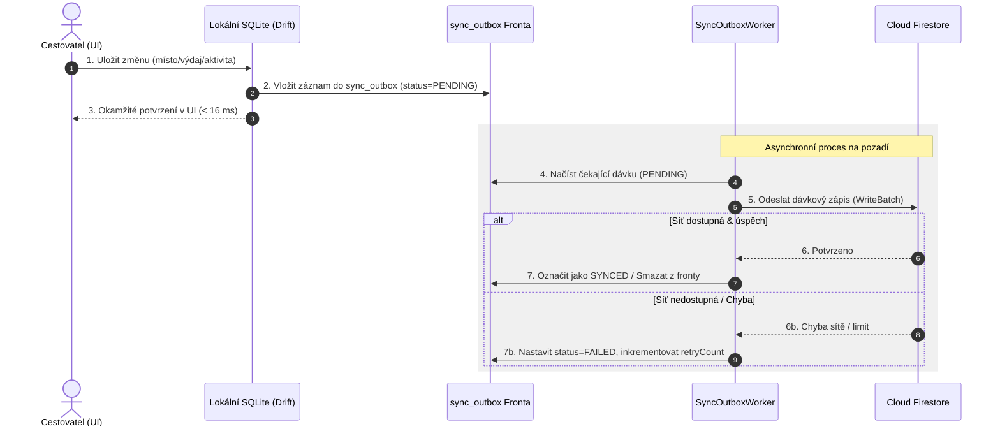

# SeoulMate v2.0 — Synchronizace a řešení konfliktů (Sync & Conflicts)

**Verze:** 2.0  
**Stav:** APPROVED SPECIFICATION  
**Poslední aktualizace:** 15. srpna 2026  
**Nadřazený dokument:** [00_MASTER_PLAN.md](00_MASTER_PLAN.md)  
**Rozcestník:** [DOCUMENTATION_INDEX.md](DOCUMENTATION_INDEX.md)  
**Datový model:** [13_DATA_MODEL.md](13_DATA_MODEL.md)

---

## 1. Outbox Pattern a architektura synchronizace

---

## 2. Deterministická pravidla řešení konfliktů (Conflict Resolution)

Protože 4 přátelé mohou upravovat data současně v offline režimu, systém používá přesná pravidla:

1. **Last-Write-Wins (LWW) s verzováním:** Každá entita obsahuje pole `version` a `updatedAt`. Pokud přijdou dvě konkurenční úpravy téhož pole, vyhrává zápis s novějším časovým razítkem.
2. **Nezávislé hlasování (Per-Member Isolation):** Každý člen má v tabulce `place_votes` svůj vlastní řádek. Hlasování dvou uživatelů o stejném místě **nikdy nekoliduje**, protože jde o dva různé záznamy, které se na klientovi pouze sečtou.
3. **Položky itineráře (Array Reordering):** Přesuny aktivit v rámci dne využívají plovoucí index pořadí (`orderIndex`).
4. **Group Decision Center:** Pokud nastane sémantický spor (např. dva členové navrhnou pro stejný časový slot dvě různé rezervace), systém nevynucuje automatický přepis, ale vytvoří záznam v **Group Decision Centru** k manuálnímu schválení skupinou.

---

## 3. Diagnostika v Sync Centru

Uživatel má v obrazovce **Sync Center** (`SCR-026`) trvalý přehled:
- Počet čekajících změn v `sync_outbox`;
- Čas poslední úspěšné synchronizace s cloudem;
- Tlačítko pro okamžité vynucení synchronizace (`Force Sync Now`);
- Seznam případných chyb s možností opakování nebo zahození konfliktní změny.
