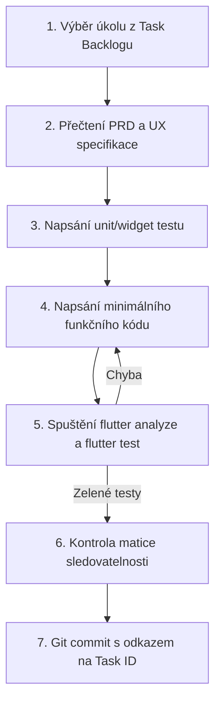

# SeoulMate v2.0 — Vývojový workflow a pravidla pro agenty (Codex Workflow)

**Verze:** 2.0  
**Stav:** APPROVED SPECIFICATION  
**Poslední aktualizace:** 15. srpna 2026  
**Nadřazený dokument:** [00_MASTER_PLAN.md](00_MASTER_PLAN.md)  
**Rozcestník:** [DOCUMENTATION_INDEX.md](DOCUMENTATION_INDEX.md)  
**Předání pro Claude Code:** [23_CLAUDE_CODE_HANDOFF.md](23_CLAUDE_CODE_HANDOFF.md)  
**Backlog úkolů:** [26_TASK_BACKLOG.md](26_TASK_BACKLOG.md)

---

## 1. Pravidla pro autonomní agenty a Codex

1. **Jeden úkol = Jeden PR:** Agent vždy zpracovává právě jeden atomický úkol z [26_TASK_BACKLOG.md](26_TASK_BACKLOG.md).
2. **Čtení dokumentace před kódem:** Před zahájením práce na úkolu si agent musí přečíst příslušné specifikace.
3. **Zákaz náhodných závislostí:** Do `pubspec.yaml` nesmí být přidán žádný balíček, který není schválen v [ZERO_COST_REGISTER.md](ZERO_COST_REGISTER.md).
4. **Zákaz rozbití stávajících testů:** Po dokončení úkolu musí projít `flutter analyze` a `flutter test`.

---

## 2. Standardní implementační cyklus agenta

---

## 3. Formát Git commitů

Každý commit musí dodržovat formát:
`feat(module): [TASK-ID] Krátký popis změny`
např. `feat(vault): [TASK-MOD-01] Implement encrypted local PDF storage for travel documents`
