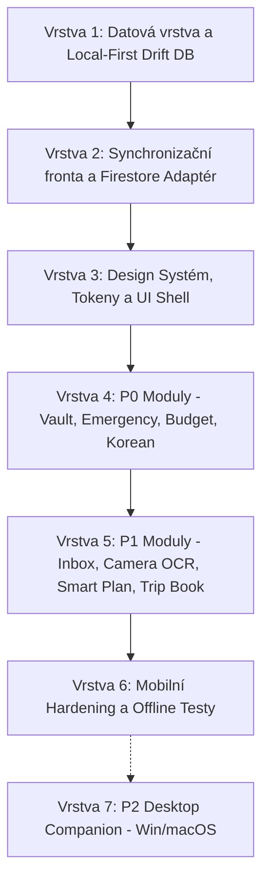

# SeoulMate v2.0 — Doporučená migrační strategie (Migration Recommendation)

**Datum auditu:** 15. srpna 2026  
**Stav:** APPROVED STRATEGY  
**Auditor:** Antigravity Architecture Lead  
**Nadřazený dokument:** [../00_MASTER_PLAN.md](../00_MASTER_PLAN.md)  
**Podrobný průvodce migrací:** [../21_MIGRATION_V1_TO_V2.md](../21_MIGRATION_V1_TO_V2.md)

---

## 1. Základní migrační princip

> [!IMPORTANT]
> **Řízená evoluce místo přepisu od nuly!**
> Existující kód pro správu uživatelů, tripů, denního plánu a hlasování o místech je kvalitní a funkční. Migrace na v2.0 proběhne v logických, na sebe navazujících vrstvách.

---

## 2. Doporučené migrační vrstvy

### Vrstva 1: Lokální perzistence (Drift / SQLite)
- Zavedení `drift` pro lokální tabulky: `trips`, `trip_members`, `trip_days`, `activities`, `places`, `place_votes`, `expenses`, `documents`, `checklist_items`, `inbox_items`, `sync_outbox`.
- Zachování zpětné kompatibility stávajících Freezed modelů jejich mapováním na Drift data classes.

### Vrstva 2: Synchronizační Outbox & Cloud Adapter
- Vytvoření `SyncOutboxRepository`, do které se ukládá každá lokální změna.
- Vytvoření `FirestoreSyncService`, která asynchronně a idempotentně odesílá dávky do Cloud Firestore.
- Odstranění / zakázání `firebase_storage`.

### Vrstva 3: UI Shell & Adaptivní Home
- Aktualizace `AppTheme` na nový v2 design systém (korejská barevná paleta Hanok stone, Seoul sky, Gingko yellow, Dancheong red).
- Přestavba `HomeScreen` na situační „Co teď?“ (dominantní akční karta + kontextové mini-karty).

### Vrstva 4: Implementace chybějících P0 modulů
- Implementace `TravelVault` s lokálním AES-256 šifrováním a offline PDF/obrázky.
- Implementace `EmergencyCenter` s rychlými kartami pro taxi, hotel a policii.
- Implementace `Budget` s vícměnovým přepočtem a split kalkulátorem.
- Implementace `KoreanCompanion` s lokálním statickým JSON obsahem.

### Vrstva 5: Doplnění P1 modulů
- `TripInbox`, `CameraCompanion` (on-device OCR), `DecisionCenter`, `TripBook` (mobilní PDF).

### Vrstva 6: Mobilní Hardening
- Komplexní testy reálného offline režimu, konfliktů a zálohování/obnovy na zařízeních Android a iOS.

### Vrstva 7: P2 Desktop Companion (Windows & macOS)
- Až po dokončení a stabilizaci mobilní verze: doplnění platforem Windows a macOS přes `flutter create --platforms=windows,macos .` a přizpůsobení širšího rozložení bez nových či exkluzivních funkcí.
